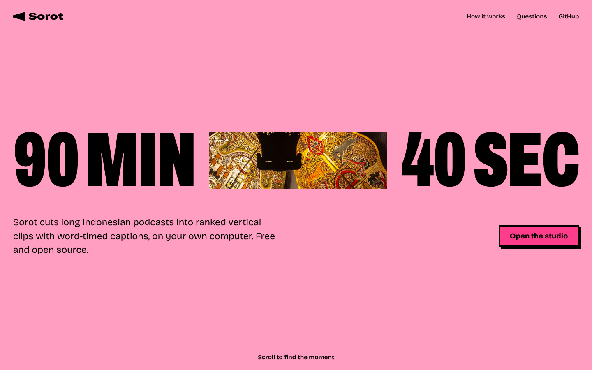
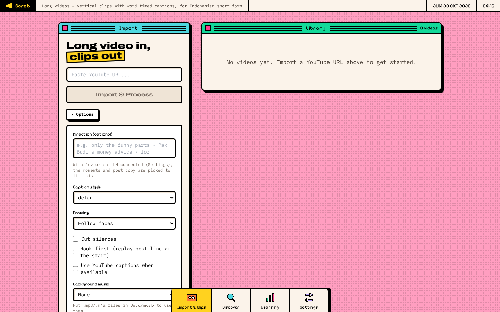
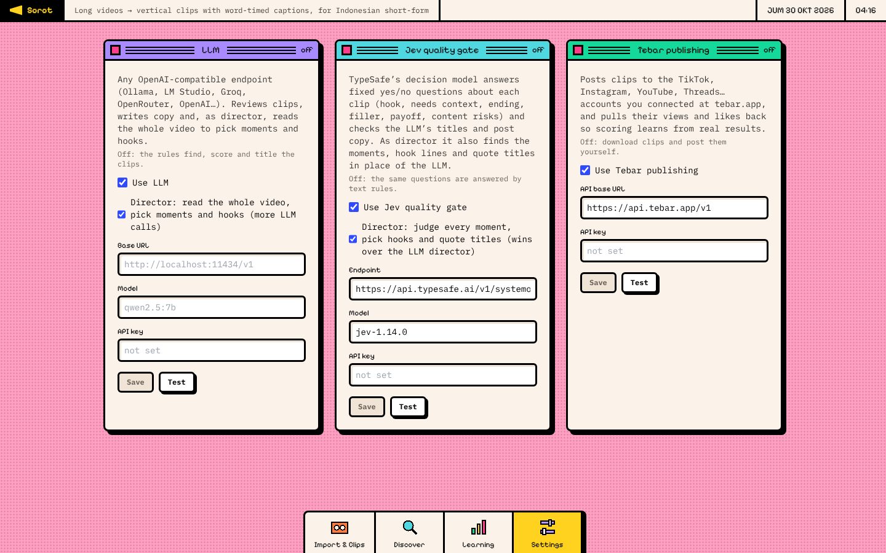
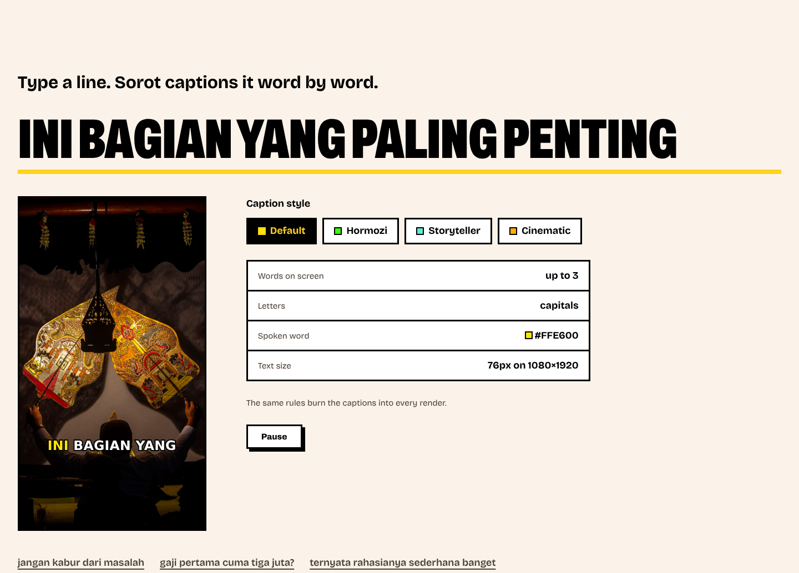
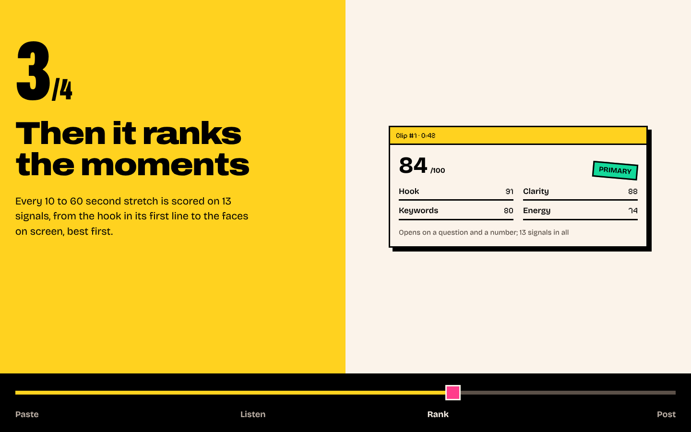
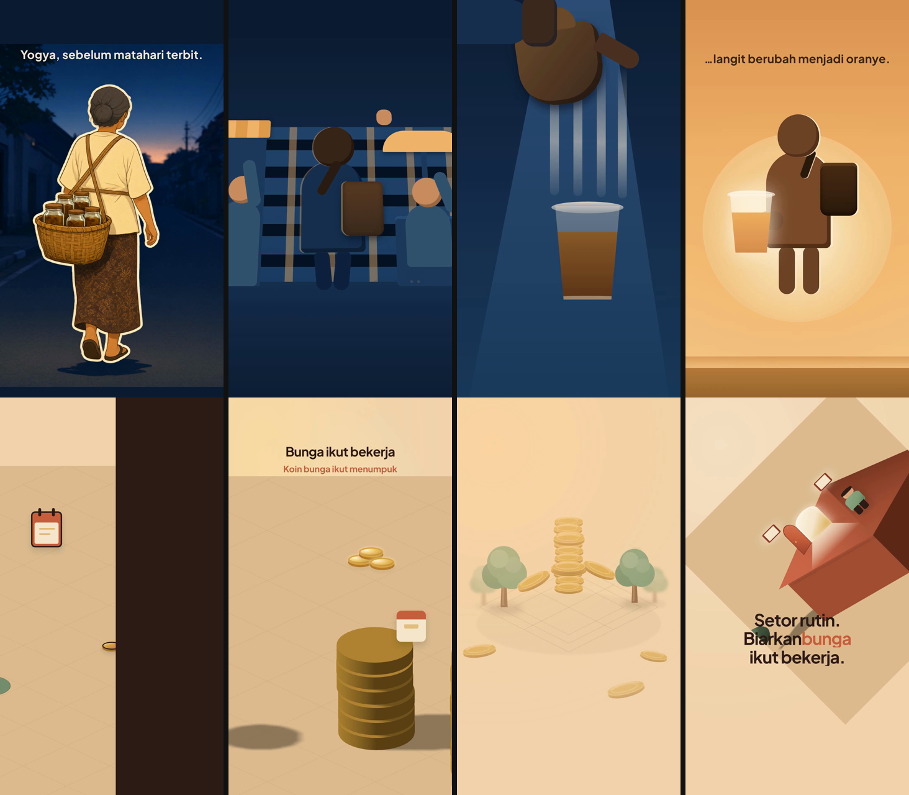

# 🎬 Sorot

> Drop in a 2-hour podcast. Get back the 60 seconds people will watch. ✂️🔥

**Sorot** (Indonesian for *spotlight*) turns long YouTube or local videos into vertical **9:16 clips**: transcribed, scored, framed on the speaker, captioned word by word, with a ready title. Built for **Indonesian**, runs **locally**. Jev, an LLM and Tebar are optional online extras. No uploads, no subscription, no watermark. 🏠

AI features default to [Kenari](https://kenari.id) (one API key), and any OpenAI-compatible endpoint works. 🙏

```
📺 video → 🎙️ Whisper → 🧠 scoring (+ optional Jev / LLM) → 📱 9:16 render → 💬 captions → 🚀 post-ready clips
```

---

## ✨ What it does

| | |
|---|---|
| 🎙️ **Transcribes** | faster-whisper `large-v3-turbo` with word timestamps, or the video's own YouTube captions |
| 🧠 **Ranks moments** | 13 weighted signals (hooks, keywords, energy, faces, motion…) → **PRIMARY / BACKUP / SKIP** |
| 🤖 **Optional LLM** | [Kenari](https://kenari.id), Ollama, Groq, OpenRouter, OpenAI or any compatible endpoint. Writes post copy, runs auto-discover, and (without Jev) directs: picks moments and hooks, follows your direction ("only the funny parts"). Director is off by default |
| 🚦 **Jev picks and gates** | [Jev](https://docs.typesafe.ai) answers fixed yes/no questions per candidate (hook, needs context, ending, filler, payoff, risks, fits your direction), then picks the hook line and a quoted title. Without it the LLM director or the rules decide |
| 🚀 **Publishes via Tebar** | TikTok, Instagram, YouTube, Threads… through [Tebar](https://tebar.app); views and likes come back into learning |
| 🎯 **Frames the speaker** | Face tracking moves the crop, cutting on scene changes |
| 💬 **Captions** | Karaoke ASS captions in 4 styles: `default`, `hormozi`, `storyteller`, `cinematic` |
| 🪝 **Hook first** · 🤫 **Silence trim** · 🎵 **Music** | Replay the best line up front; cut pauses from video, audio and captions; loop `data/music` tracks ducked under speech |
| ✏️ **Edit** | Nudge timing, fix a word, change style: one clip re-renders in ~20 s |
| 🔎 **Finds sources** | Auto-discover, search and a channel crawler |
| 📈 **Learns** | After 5+ results the weights re-fit to your numbers |
| 🎞️ **Generate** | Optional second mode: a written brief becomes a finished 2D motion video, no source footage. A director model plans it (you approve), writes each shot with HyperFrames, and two verdicts (code, then a fresh judge) decide if it ships. Needs an LLM; clipping never does. [docs/generate.md](docs/generate.md) |
| ⌨️ **Scriptable** | `sorot` CLI and a plain HTTP API |

---

## 📸 Screenshots



| 🎬 Studio: import with options | 🔌 Settings: LLM, Jev and Tebar |
|---|---|
|  |  |
| 💬 **Captions**: 4 styles | 🏅 **Ranking**: 13 signals per moment |
|  |  |

Captions and ranking are the landing page's live demo.

### 🎞️ Generate: two films from a written brief




Full films (9:16, silent here): [the Yogya story, 30 s](docs/screenshots/generate-sample-story.mp4) · [why a ship floats, 30 s](docs/screenshots/generate-sample-ship.mp4). Drafts from real runs, shrunk to 540×960, not picked for passing every check; they can have small flaws. What the verdicts found and what the bench measured: [docs/generate.md](docs/generate.md).

---
## 🚀 Install

Images on **`ghcr.io/raufimusaddiq/sorot`** (CPU `:latest`, NVIDIA `:latest-cuda`), published per release. No build; the installers pick for you. Then open 🌐 **http://localhost:8080/studio**.

**🪟 Windows** (Docker Desktop, PowerShell, no git needed):

```powershell
powershell -ExecutionPolicy Bypass -c "irm https://raw.githubusercontent.com/raufimusaddiq/sorot/master/scripts/install.ps1 | iex"
```

Add `-Mode native` for Bun, Python and ffmpeg directly on Windows, no Docker (see [install.md](docs/install.md)).

**🐧 Linux** (Debian, Ubuntu and friends):

```bash
git clone https://github.com/raufimusaddiq/sorot.git && cd sorot
scripts/install.sh                 # 🐳 Docker (recommended)
scripts/install.sh --mode native   # 🧩 or Bun + Python + systemd
```

**🐳 Docker, any OS:** `docker compose --env-file .env.docker up -d backend` (CPU). 🎮 **NVIDIA** needs a `docker-compose.override.yml`.
**🍎 macOS:** CPU only, manual steps. **⌨️ CLI only:** one binary that drives a Sorot elsewhere.

📖 GPU override, updates, Whisper model download, macOS, CLI binary, native Windows options: [docs/install.md](docs/install.md) · [docs/linux-install.md](docs/linux-install.md)

💻 **No GPU?** Everything runs on the CPU, with fewer clips rendered by default (the best 10 per video, `MAX_RENDER_CLIPS`; the rest are one **Render** click away). Whisper is the slow part: try `WHISPER_BEAM_SIZE=1`, `WHISPER_MODEL=small` or `YOUTUBE_CAPTIONS=true`. Timings: [docs/install.md](docs/install.md#-no-graphics-card).

---

## 🎞️ Making clips

1. 🌐 Open **http://localhost:8080/studio**
2. 🔗 Paste a YouTube URL or pick a file, then **Import & Process** (⚙️ **Options**: caption style, framing, silence trim, hook first, music, or a range like **13:25 → 25:00**)
3. ⏳ Watch the 9 stages
4. 🏆 Filter **PRIMARY / BACKUP / SKIP** and preview (on a CPU, **Render** clips past the top 10)
5. 📋 Copy the title and description, download the `.mp4`
6. ✏️ **Edit** timing or a word, re-render that clip
7. 📊 Post, log the results (**Results**); after 5+, **Retrain scoring** in Learning

---

## ⌨️ `sorot`: the command line

```bash
sorot import "https://youtu.be/…" --style hormozi --trim --hook   # 🎬 import, wait, list clips
sorot import ~/Videos/talk.mp4 --from 13:25 --to 25:00            # ✂️ one section of a file
sorot clips <video> --tier PRIMARY                                # 🏆 the best clips
sorot download --video <video> -o ~/clips                         # 💾 grab the .mp4s
sorot rerender <clip> --start 61 --end 100                        # ✏️ fix one clip's timing
sorot discover auto "podcast bisnis"                              # ✨ agent finds source videos
sorot discover search "podcast indonesia"                         # 🔎 or search yourself
sorot connect setup                                               # 🔌 Jev, LLM, Tebar: asks, saves, tests
sorot publish <clip>                                              # 🚀 pick accounts, check copy, post
sorot posts <clip> · sorot sync                                   # 📊 post status · numbers into learning
sorot gen new "a 30 s explainer about …" · sorot gen build <video>  # 🎞️ brief → 2D video (Generate)
sorot up | down | logs -f | doctor                                # 🛠️ run the app
```

`--json` for scripts, `--url` / `SOROT_URL` for another machine. 📖 [docs/cli.md](docs/cli.md) · 🔌 Batch import, watched folders, timers, Python: [docs/integration.md](docs/integration.md)

---
## 🧠 How it works

```
YouTube URL / file ──► Bun API ──► 9-stage pipeline
                     1. 📥 Import        yt-dlp (or a time range)
                     2. 🔊 Audio         ffmpeg
                     3. 🎙️ Transcribe    faster-whisper, word timestamps
                     4. ✂️ Segment       gap-based candidates + Jev-judged sentence windows (or the LLM director)
                     5. 🧠 Score         13 signals + Jev (or LLM review), quality gate, hook + title
                     6. 📱 Render 9:16   crop, silence trim, hook, captions + music, one encode
                     7. 💬 Captions      (re-burns only clips rendered the old way)
                     8. 🔁 Variations    zoom presets (off unless VARIATIONS=true)
                     9. 📊 Analytics     distribution + recommendations
              Web UI · sorot · scripts ◄── HTTP API (port 8080)
```

### 🏅 Scoring

13 weighted signals (`ai-pipeline/weights.json`, or your learned `data/weights.json`): 🪝 hook 17% · 🙂 face 9% · 🔍 clarity 9% · 🔑 keywords 8% · 💡 novelty 8% · ⚡ energy 8% · 🎬 scene change 7% · 🎯 topic fit 7% · ⏸️ pauses 6% · 📚 history 6% · 😊 sentiment 5% · 🏃 motion 5% · 🥁 onsets 5%. Detail per signal: [docs/scoring-spec.md](docs/scoring-spec.md).

🏆 **PRIMARY** ≥ 0.78 · 🥈 **BACKUP** ≥ 0.63 · 💤 **SKIP** < 0.63. With Jev (or else an LLM) the score is 50% formula, 50% its judgement; if it is unreachable, the formula decides. Each clip records who scored it and why.

### 🎬 Director, 🚦 gate, 🚀 publishing

- 🎬 **Director** (Jev first): code proposes a window at every sentence start, Jev judges them and keeps the best 40 next to the rule windows, scores up to 200 candidates, and picks the hook line and a quoted title for clips that render. On 10 min of a real transcript, segmenting and scoring took ~10 s with Jev (about $0.01 at TypeSafe's listed price) against 6.5 to 9 min with a reasoning LLM as director. Without Jev (or `JEV_DIRECTOR=false`) the **LLM director** reads the video, writes a brief and picks moments and hooks. Overlaps keep the better clip; give a **direction** at import to steer it.
- 🚦 **Gate** before render: PASS / REVIEW (content risk, you decide) / FAIL (held back, renderable on request). Jev when connected, text rules otherwise. Measure the questions with `bun run jev-eval`.
- 🤖 **The LLM** writes post copy per platform and runs the ✨ auto-discover agent.
- 🚀 **Publish** (Tebar), in the studio or `sorot publish`: pick accounts (grouped by Tebar workspace), get LLM copy per platform, edit and choose (TikTok privacy or draft, YouTube "made for kids"), post or schedule, retry failed accounts or cancel a scheduled post. Metrics sync every 6 h into learning.

👉 [docs/creative-loop.md](docs/creative-loop.md): design, questions and their sources.

### 🔬 What is actually "AI" here?

Whisper is a neural network, and so is the LLM if you add one. Faces use classic ML (Haar cascades). The clip score is a **hand-tuned formula** (fast, explainable, offline), not a trained model; LightGBM can take over after 200+ real results. 👉 [docs/ai-audit.md](docs/ai-audit.md)

### 📈 Learning

📤 Views, likes, comments, shares, saves (from Tebar or typed in) → 🧮 a time-normalised viral score → 🔄 after 5+, **Retrain scoring** (Pearson + EMA, α = 0.3) → ✅ the next import uses them. Learned weights live in `data/weights.json` and survive updates.

### 🔎 Discovery

Finds **long-form sources** (podcasts, talk shows, stand-up, VODs), not other people's clips: re-clips filtered, 30 min and longer favoured, last 90 days by default.

- ✨ **Auto-discover**: the LLM agent reads what Indonesians talk about now, searches YouTube, reads captions, picks with reasons. No LLM: random anchor queries, best scores, ≤ 2 per channel.
- 🧾 **Whole-video scoring** in 45 s caption windows: strong moments, best timestamps, talk ratio, with a reason like "3 strong moments, best at 4:38".
- 📡 **Channel crawler** profiles sources and rejects clip farms; queue the best in one go.

### 📝 Titles and descriptions

Every clip gets a **title** (hook + hashtags, ≤ 100 chars) and a **description** (hook, summary, 7 hashtags, CTA), one click to copy.

---
## ⚙️ Configuration

Set in `.env.docker` (Docker), `/etc/sorot/sorot.env` (native Linux), `.env.native` (native Windows) or `backend/.env` (dev); most also per import. LLM, Jev and Tebar can be set in the app (**Settings**) or with `sorot connect`, and win over the variables. Keys go in `.env.llm` (gitignored).

| Variable | Default | |
|---|---|---|
| `WHISPER_MODEL` / `WHISPER_DEVICE` | `large-v3-turbo` / `cpu` (`cuda` on GPU installs) | `small` is faster on CPU |
| `SUBTITLE_STYLE` · `REFRAME_MODE` | `default` · `face` | `hormozi`, `storyteller`, `cinematic` · `center`, `blur` |
| `SILENCE_TRIM` · `HOOK_FIRST` | `false` · `false` | cut pauses · replay the best line first |
| `MAX_RENDER_CLIPS` | `10` on CPU, all on GPU | the rest render on request |
| `LLM_BASE_URL` · `LLM_MODEL` · `LLM_API_KEY` | empty (off) | any OpenAI-compatible endpoint |
| `JEV_API_KEY` | empty (off) | Jev gate and director ([TypeSafe](https://docs.typesafe.ai)) |
| `TEBAR_API_KEY` | empty (off) | publishing via [Tebar](https://docs.tebar.app/api) |

📖 Every variable: [docs/configuration.md](docs/configuration.md). Generate's settings: [docs/generate.md](docs/generate.md).

---

## 🧰 Tech stack

| Part | Tech |
|-----------|------|
| 🟨 Backend | Bun + TypeScript (`bun:sqlite`, no runtime deps): API, scoring, discovery, LLM agent, serves the UI |
| 🐍 Media | Python 3 · faster-whisper · OpenCV · NumPy · ffmpeg / libass · yt-dlp |
| 🎞️ Generate | HyperFrames (pinned, Node ≥ 22), GSAP, Three.js (vendored) |
| 🤖 LLM | Any OpenAI-compatible endpoint (optional) |
| ⚛️ Frontend | Next.js 14, static export |
| 🗄️ Database | SQLite |
| ⌨️ CLI | `sorot`, one compiled Bun binary |
| 🐳 Runs on | Docker (GHCR, CPU or CUDA) · native Linux · native Windows · macOS via Homebrew |

### 🗂️ Layout

```
├── backend/        🟨 Bun/TS API, orchestrator, scoring, discovery, Generate, UI host (+ Dockerfile)
├── ai-pipeline/    🐍 Python media scripts (transcribe, render, reframe, subtitle, …)
├── generator/      🎞️ Generate's tool bundle: HyperFrames, prompts, fonts, recipes, kit parts
├── frontend/       ⚛️ Next.js UI (static export → frontend/out)
├── cli/            ⌨️ sorot client
├── scripts/        🛠️ install.sh (Linux) · install/start/stop/verify/e2e .ps1 (Windows)
├── docs/           📚 specs and guides
├── specs/          📋 spec kit for Generate
└── data/           💾 your videos, clips, database (gitignored)
```

### 🧑‍💻 Development

```bash
bun install                        # one lockfile for backend + frontend + cli
bun run build && bun run start     # UI → frontend/out, backend on :8080
cd backend && bun test --coverage  # 🧪 backend
cd cli && bun test --coverage      # 🧪 CLI
cd frontend && bun run test        # 🧪 UI (jest)
cd ai-pipeline && .venv/bin/python -m pytest tests   # 🧪 pipeline
```

✅ Gate: 100% passing, ≥ 95% coverage, zero type errors.

### 📦 CI and releases

- 🧪 [`ci.yml`](.github/workflows/ci.yml): tests on pushes to `master` and every PR; image-affecting changes also build the **CPU** image (not pushed) and smoke-test it.
- 🚀 [`release-image.yml`](.github/workflows/release-image.yml): builds and pushes **CPU and CUDA** images on a **GitHub release** (`v1.2.3` → `:1.2.3`, `:1.2`, `:latest`, plus `-cuda`; pre-releases keep `:latest`) or a **manual run** (Actions → *Release image*).

To ship: 📋 [docs/release.md](docs/release.md). What changed: 📰 [CHANGELOG.md](CHANGELOG.md).

---

## 📚 Docs

| | |
|---|---|
| 📦 [install.md](docs/install.md) | Every install path: Windows, Docker, GPU, macOS, CLI binary, CPU timings |
| ⚙️ [configuration.md](docs/configuration.md) | Every environment variable |
| 🐧 [linux-install.md](docs/linux-install.md) | Installer modes, files, updating, troubleshooting |
| ⌨️ [cli.md](docs/cli.md) | Every `sorot` command and flag |
| 🔌 [integration.md](docs/integration.md) | Scripts, timers, watched folders, HTTP API, Python |
| 🌐 [api-spec.md](docs/api-spec.md) | HTTP API reference |
| 🏗️ [architecture.md](docs/architecture.md) | How the pieces fit |
| 🏅 [scoring-spec.md](docs/scoring-spec.md) | Scoring in depth |
| 🔬 [ai-audit.md](docs/ai-audit.md) | Model vs rule vs LLM |
| 🎬 [creative-loop.md](docs/creative-loop.md) | Jev director, LLM director, quality gate, Tebar publishing |
| 🎞️ [generate.md](docs/generate.md) | Generate; also [recipes](docs/generate-recipes.md), [kit](docs/generate-kit.md), [director loop](docs/director-loop.md), [porting](docs/generate-porting.md) |
| 🐍 [python-pipeline.md](docs/python-pipeline.md) | Each pipeline script's inputs and outputs |
| 🚀 [release.md](docs/release.md) · 📰 [CHANGELOG.md](CHANGELOG.md) | Cutting a release · what each changed |

---

## 🗺️ Roadmap

- 🎯 **Calibrate the gate** on real labelled clips (`bun run jev-eval`) and feed its answers to training as features
- 💬 **Comments**: Tebar comment inbox with LLM-drafted replies you approve

---

## 🙏 Thanks

[Kenari](https://kenari.id), Sorot's default AI provider, supports this project through the Kenari Grant. It stays optional and swappable: Settings and `sorot connect llm` always offer a plain OpenAI-compatible endpoint, with no Kenari key required.

---

## 📄 License

[MIT](LICENSE) © 2026 Raufi Musaddiq: use, modify, share, even commercially; keep the notice. 🔓

Bundled tools keep their own licenses: ffmpeg (LGPL/GPL), yt-dlp (Unlicense), faster-whisper and Whisper models (MIT), OpenCV (Apache-2.0), LightGBM (MIT). Redistributing the image means following them too. Downloading or clipping videos is subject to platform terms and creators' rights.
